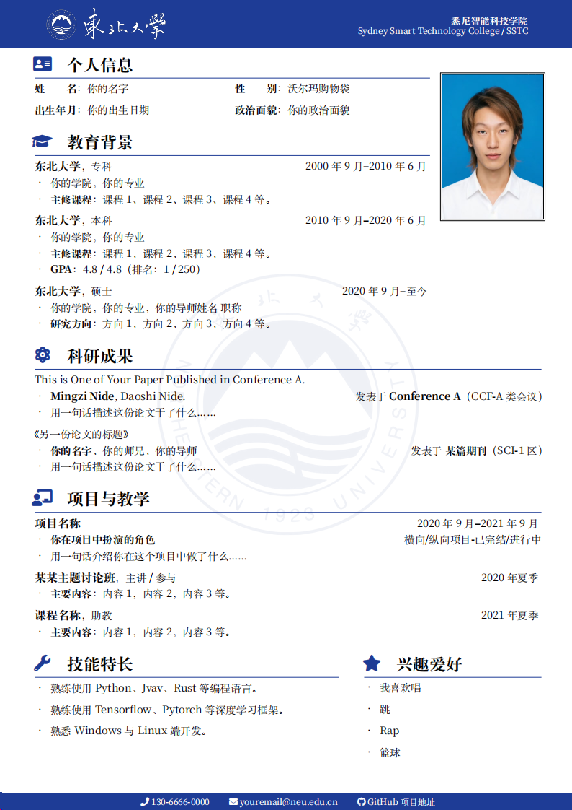

# NEU-CV：东北大学 LaTeX 中文简历模板

## 简介

基于 [东南大学 LaTeX 中文简历模板](https://www.overleaf.com/project/6ae2d601537127bac731e5ea) 修改而来的东北大学中文 CV 模板。

## 使用方法

1. 编辑 `main.tex` 中的内容，对文档样式和内容进行修改。
2. 使用 `XeLaTeX` 或 `LuaLaTeX` 编译。
3. **图片准备**：请在项目根目录下创建 `images` 文件夹，并放入以下三张图片（**命名不可更改**）：
   - `neu-header.png`：页眉的东北大学校标与校名组合图
   - `neu-watermark.png`：背景居中水印图
   - `photo.jpg`：个人证件照（代码中已做占位兜底，若暂无图片会自动生成虚线框提示）